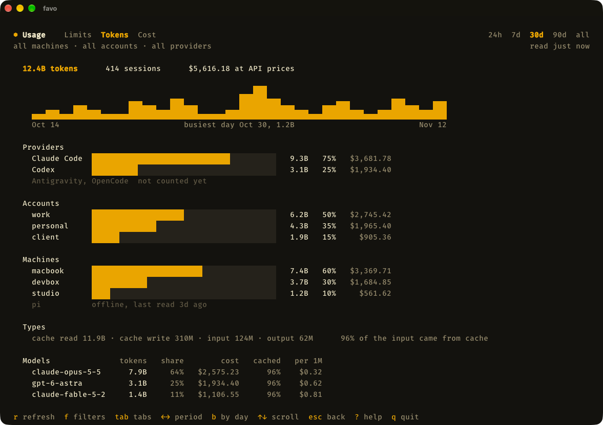

<p align="center">
  
  
</p>

<h3 align="center">Every AI subscription you have, on every computer you own.<br>No more logging in and out.</h3>

<p align="center">
  <a href="https://www.npmjs.com/package/favo-cli"></a>
  <a href="https://github.com/irwinarruda/favo-cli/actions/workflows/ci.yml"></a>
  <a href="LICENSE"></a>
  
</p>

<p align="center">
  <a href="#install">Install</a> ·
  <a href="#what-you-get">What you get</a> ·
  <a href="#supported-providers">Providers</a> ·
  <a href="#how-it-works">How it works</a> ·
  <a href="#faq">FAQ</a>
</p>

<p align="center">
  
  
</p>

favo runs Claude Code, Codex, Antigravity CLI and OpenCode under as many accounts as you have, at the same time, on all your machines. Each account keeps its own login and threads. Your `CLAUDE.md`, skills and settings follow you into all of them.

**Before**

```sh
claude auth logout
claude auth login      # the browser again, the other account, and your place is gone
```

**With favo**

```sh
favo claude work       # Claude Code as work
favo claude personal   # and as personal, in the next tab
favo codex client      # Codex as a client's account
```

## Install

```sh
npm install --global favo-cli           # macOS, Linux and Windows
brew install irwinarruda/tap/favo-cli   # or Homebrew, on macOS and Linux
```

Everywhere you install it, the name is `favo-cli`. The command you run is `favo`. The npm install needs Node 20.11 or newer, and Homebrew needs nothing else ([details](#install-details)). To try it without installing, use `npx favo-cli`; plain `npx favo` runs an unrelated package.

Your first account is already there: `personal` is the setup you have today. To add another:

```sh
favo add work            # a new cell
favo login claude work   # sign in, with Claude's own login
favo claude work         # go
```

## What you get

### Every account, signed in, at once

There is nothing to switch. Each account lives in its own cell, so a work session and a personal session can run side by side, and neither signs the other out.

### Your setup, written once

Skills, `CLAUDE.md`, `AGENTS.md`, hooks and settings are linked into every account from your normal config folders. Edit a skill once and every account sees it. Logins and threads stay private to their cell.

### Your other computers, in the same view

Add a machine once. favo installs itself there, and from then on that machine sits in the same view, and every action works on it: launch, sign in, add an account. It works over ssh or Tailscale, with no ports, tunnels or daemons.

```sh
favo machine discover         # what is on ssh and Tailscale
favo machine add bee@devbox   # connect, and install favo there
favo --machine devbox claude work
```

Choosing where a provider starts works remotely too. Here the Mac is browsing the real folders on a Linux box:

<p align="center">
  
</p>

When a machine falls behind, favo says so and keeps it working. Press `U` to update them all:

<p align="center">
  
</p>

### Your place, kept

Close a provider and the thread is still there. Press `b` on a seat, or run `favo resume claude work`, and you are back in it, in its own folder. Two sessions in one folder are both kept, and `b` lets you pick.

```sh
favo hooks install                     # let your providers tell favo their thread
favo resume claude work             # the newest thread in this folder
favo resume claude work --model x   # the same, with a one-off option
favo threads claude work            # everything that seat kept
```

Your `launchArgs` come back by themselves. A one-off option does not, so pass it again.

To know which thread you are in, favo adds one small hook to your provider config, and only once you ask. [The reference](#reference) spells out exactly what it does. Run Herdr? A restart brings each seat back on the right account, in the same thread.

### What you have left, and what you used

Press `u` for the limits of every seat on every machine, and when each comes back. Press `t` for the tokens those seats used, by provider, account, machine and model, over the last day, week, month, quarter or all time. Press `c` for the same in dollars, at API list prices. `f` narrows any of the three to the machines and accounts you pick.

<p align="center">
  
</p>

```sh
favo usage                    # what every seat has left
favo usage --tokens           # what every seat used
favo usage --cost --days 7    # the same in dollars, for the last week
```

favo counts from the session logs Claude Code and Codex already keep, reading only numbers, and keeps its own count, so a month Claude Code has deleted is still there.

### A TUI you will want to leave open

See every machine, account and login, spot what needs signing in, and press `enter` to launch. Prefer scripts? Everything is a command too, and `favo list --json` gives you the same view as data.

Twelve themes come built in, with a live preview, and your own is a small JSON file away:

<p align="center">
  
</p>

### Works with what you already use

Your `~/.claude`, `~/.codex` and the rest stay where they are, and an old config folder can move in with `favo adopt claude work ~/.claude-work`. Using [T3 Code](#use-it-with-t3-code)? Press `c` on any seat to copy the path it needs.

## Desktop apps

favo can also open the **Claude** and **ChatGPT** desktop apps as any account. Press `p` on a seat, or run:

```sh
favo app claude work         # Claude, as work
favo app codex work          # ChatGPT, as work
favo app claude personal     # back to the app you always had
favo app claude work --close # close it first if it is open
```

The first time, sign in inside the app. It remembers each account after that, and the Claude Code or Codex inside it uses the same seat as the CLI, so it sees the same settings and its threads land in the same place. `p` only appears when the app is installed on the computer you are at. If the app is already open, favo asks first:

<p align="center">
  
</p>

> [!WARNING]
> **This is unofficial.** Neither app documents running several accounts, so an update could break it. Your apps themselves stay as they were, and `personal` always opens the default one.

ChatGPT signs in through the Codex in the seat, so it shares the CLI's login. Claude does not: the Claude app and Claude Code sign in separately, even in the same seat. So a Claude seat with the app shows both in the comb: `⬢ claude` for Claude Code, and a small `app` tag at the end of the row for the app. The tag is filled in honey when the app is signed in and plain when it is signed out. `app?` means favo can't tell, which is how a seat looks from the first time favo opens its app until you sign in. The cell says it in words. `s` signs in Claude Code, and `p` opens the app to sign in there. After `p`, the comb watches that seat for three minutes, so your sign-in in the app shows up on its own. Seats on your other machines show their app too, read on that machine over SSH once favo there is up to date, but `p` opens the app only on the computer you are at.

If the app and Claude Code are signed in to different accounts, the tag turns red, because it costs you: the Code tab in the app spends the app's account, while its threads land in the seat. favo tells them apart by reading two settings the app keeps in its own folder, which an app update could rename. If the sign-in setting is renamed, the comb shows `app?` rather than signed out. If the account setting is renamed, the comb still shows the app signed in, but it can no longer warn you about another account.

- One account at a time, per app. favo closes the app to switch, and anything running in it stops.
- Opening the app from the Dock or Start menu uses your default account, not the last one favo opened.
- A login stays on the computer where you signed in. It does not travel to your other machines.
- On Windows, Cowork may not work outside your default account, and a sign-in that bounces to your browser can get lost. Use the emailed code if it does.
- macOS, Windows, and the official Linux packages for Ubuntu and Debian. In WSL, run favo on Windows instead.

## Supported providers

| Provider        | Private to each account | Shared across accounts                                                     |
| --------------- | ----------------------- | -------------------------------------------------------------------------- |
| Claude Code     | login, threads, history | CLAUDE.md, settings, skills, agents, commands, hooks, plugins, keybindings |
| Codex           | login, threads, history | AGENTS.md, config.toml, hooks.json, skills, agents, rules, prompts         |
| OpenCode        | logins, threads         | all of its config                                                          |
| Antigravity CLI | conversations           | GEMINI.md, settings, skills, plugins                                       |

> [!WARNING]
> **Antigravity is the exception.** Conversations are separate per account, but favo could not verify that its login is, and the TUI says so on that seat. It also runs in a private home folder that mirrors yours, so it can see your other files there, not only the shared list above.

## How it works

_favo_ means honeycomb in Portuguese and Italian. Each account is a sealed cell, and the walls between cells are shared.

Your `personal` account is the labs' own folders, untouched. Every other account gets its own folder, and favo starts the official CLI pointed at it:

```text
~/.favo/accounts/
  work/
    claude/    CLAUDE_CONFIG_DIR points here
    codex/     CODEX_HOME points here
  side/
    claude/
```

Inside a cell, an item is either shared or private. Shared items are a named list per provider, linked back to your own config. Everything else stays private to the cell, including anything a provider adds next year. Links are checked at launch and with `favo sync`, and a real file where a link belongs is reported and left alone.

## FAQ

**Is favo a proxy? Does it pool or rotate accounts?**
No. favo starts the official CLI with the right folder set, then gets out of the way. Your requests go straight from that CLI to its provider, and you always choose which account runs.

**Can favo see my tokens?**
favo never reads them. (These are login tokens. The tokens `favo usage --tokens` counts are a different thing: numbers in the session logs, read without the text around them.) Logins run each provider's own command, and credentials stay wherever that provider keeps them. To tell whether the Claude app is signed in, favo reads two settings from the app's own `config.json`, whether it is signed in and which account, and the account id from Claude Code's `.claude.json`. It keeps nothing else from either file, and the token in `config.json` is encrypted with your system's key. One thing to watch: settings are shared, so an API key you put in `settings.json` or `config.toml` is visible to every account.

**What happens to my existing config?**
It stays where it is and becomes your `personal` account. Shared items in other accounts are links to it, so editing one edits your original. favo changes it in one case, and only when you ask: `favo hooks install` adds its own hook, leaves yours alone, and `favo hooks uninstall` takes it out again.

**Does favo phone home?**
There is no telemetry, and favo never checks for updates by itself. Its own network use is two downloads from GitHub. One is its release: on the npm package's first run, and when it installs itself on another machine. The other is LiteLLM's public price table, a plain file fetched at most once a day, and only when you open the Tokens or Cost page or run `favo usage --tokens` or `--cost`. Nothing about you or your usage is sent with it. Reaching your machines goes over your own ssh. `favo update` runs your package manager, and with `--providers` the providers' own update commands, only when you run it. The versions in the comb come from the binaries on each machine, never from the internet.

**Why not a shell alias with `CLAUDE_CONFIG_DIR`?**
That gives you a second login, and it's how many of us started. The new folder starts empty, though, so you maintain your setup twice, and it stops at one machine and one provider. favo keeps the setup shared and does the same for all four providers, across your computers.

**How do I uninstall it?**
Run `favo hooks uninstall` first, so no hook stays behind in your provider config. Then run `npm uninstall --global favo-cli` or `brew uninstall favo-cli`, and delete `~/.favo`. If you forget the first step, nothing breaks: the hook stays silent with favo gone. That removes every account except `personal`, along with their logins and threads, and leaves your normal config folders alone.

## Reference

### Install details

| System  | Supported                                 |
| ------- | ----------------------------------------- |
| macOS   | Apple Silicon and Intel                   |
| Linux   | x64 and arm64, glibc (not Alpine or musl) |
| Windows | x64                                       |

The npm package is a small launcher with no dependencies and no install scripts. The first run downloads the right binary, about 40 MB, from [GitHub Releases](https://github.com/irwinarruda/favo-cli/releases) and checks it against the hashes published in the npm package. After that, favo starts with no network. Homebrew installs the same binary directly, with no launcher and no Node.

To update, run `favo update`. It updates favo here, then on every other machine. `favo update --providers` does that too, then updates the provider CLIs everywhere. favo marks a machine on an older version as `older favo` and keeps it working until you do. favo 0.4.0 and earlier have no such command, so update those once by hand: `npm install --global favo-cli@latest`, or `brew update` and then `brew upgrade favo-cli`.

### Use it with T3 Code

T3 Code starts providers itself, so it only needs the folder. Select a seat, press `c`, and paste into a Claude provider's **CLAUDE_CONFIG_DIR path** or a Codex provider's **CODEX_HOME path**.

### Commands

```sh
favo                         # open the comb
favo add work                # a new cell
favo login claude work       # sign in, with the official command
favo logout claude work      # sign out
favo claude work             # run Claude Code as work
favo claude work --chrome    # everything after the account goes to Claude
favo --dir ~/app claude work # start it in that folder
favo resume claude work      # back to the newest thread here
favo resume claude work 2    # back to the second one in favo threads
favo threads claude work     # the threads a seat kept
favo hooks install           # let providers tell favo their thread
favo hooks status            # is that working, seat by seat
favo hooks uninstall         # take favo's hook out again
favo list                    # every machine, account and login
favo usage                   # what every seat has left, and when it comes back
favo usage --tokens          # what every seat used, by provider, account and machine
favo usage --cost            # the same, in dollars at API list prices
favo usage --tokens --json   # every day of it, for a script or a site
favo update                  # favo, on every machine
favo update --providers      # favo, then the provider CLIs, on every machine
favo rename work client      # a new name, on this machine
favo rm work                 # move a cell to the trash
favo sync                    # repair shared links
favo inspect claude work     # what is shared and what is private
favo path claude work        # print the config path
favo app claude work         # open the Claude app as work
favo theme tokyo-night       # pick a theme
```

Providers are `claude`, `codex`, `agy` and `opencode`. Most commands take `--machine <machine>` to run on another computer. When favo starts a provider, favo's own options go before the provider, and everything after the account goes to the provider, flags and prompt included. `favo --help` lists the rest.

`favo usage` and the `u` screen have three pages: Limits, Tokens and Cost. Limits is the default, and `--limits`, `--tokens` and `--cost` pick one. Every page takes `--machine`, `--account` and `--provider`, each as many times as you like, and `--json`. In the TUI, `l` `t` `c` change the page and `f` opens the same three filters.

**Limits** asks Claude Code and Codex through their own commands, so no token is read and no thread starts. OpenCode and Antigravity show no limits for now, because neither has a source that works without a token. favo reads them once when the TUI opens, so the numbers are ready when you press `u`, and `favo usage` reads them when you run it. The bars show what is left: the thick part is yours now, the thinner part is what the next reset gives back, and the tall mark is how much of the window's time is left, so a bar that stops short of it is spending too fast.

**Tokens** counts what each seat used, from the session logs Claude Code and Codex already keep on each machine. favo reads only numbers, times, model names and ids from them, never the text of a message. Claude Code deletes its logs after 30 days, so favo keeps its own count by hour in `~/.favo/usage` and only ever raises it. It counts once a day when the TUI opens, and again when you open the page or run the command. The same account on two machines is counted on both, because tokens are work done. OpenCode and Antigravity are not counted yet. `--days <n>` sets the period, 30 when left out, and `--all` is everything favo has kept. In the TUI, `1` to `5` or the arrows pick 24 hours, 7, 30 or 90 days, or all.

**Cost** is the same count in dollars: what the API would charge for those tokens at list prices, not what your subscription bills you. The prices are LiteLLM's public table. Every model is priced at its base rate, with no long-context or fast-mode tiers. A model the table does not know is counted in tokens and left out of every dollar.

`favo rm` keeps the cell in `~/.favo/trash`, login included, until you delete that folder yourself. `favo adopt` refuses a folder inside `~/.favo` or a provider's base folder.

<details>
<summary><strong>Keys in the TUI</strong></summary>

| Key                 | Does                                |
| ------------------- | ----------------------------------- |
| arrows or `h j k l` | move around                         |
| `enter`             | launch the selected seat            |
| `b`                 | go back to a thread                 |
| `s` / `o`           | sign in / sign out                  |
| `c`                 | copy its config path                |
| `u`                 | limits, tokens and cost             |
| `v`                 | see every provider CLI version      |
| `d`                 | choose the folder it launches in    |
| `a`                 | add an account                      |
| `n`                 | rename the selected cell            |
| `x`                 | delete the selected cell            |
| `m`                 | add a machine                       |
| `i`                 | install or update favo on a machine |
| `U`                 | update favo on every machine        |
| `P`                 | update provider CLIs on a machine   |
| `X`                 | forget a machine                    |
| `r` / `R`           | refresh / repair shared links       |
| `t`                 | pick a theme                        |
| `?`                 | help                                |
| `q`                 | quit                                |

The base cell can be renamed but never deleted. A rename only changes the name you see, so logins, threads and paths keep working.

</details>

<details>
<summary><strong>Threads and hooks</strong></summary>

A provider writes its thread ID straight to the terminal as it closes, so favo cannot read it there. Instead, each provider tells favo the ID while it runs, through a hook, and favo keeps it in `~/.favo/threads`.

`favo hooks install` adds that hook to your base config, once per machine, so every account gets it:

| Provider    | Where                                       |
| ----------- | ------------------------------------------- |
| Claude Code | a `SessionStart` entry in `settings.json`   |
| Codex       | a `SessionStart` entry in `hooks.json`      |
| OpenCode    | a plugin in `~/.config/opencode/plugins`    |
| Antigravity | a `PreInvocation` entry in `.gemini/config` |

- It does nothing outside favo. The hook only runs favo inside a provider favo started, so a plain `claude` never starts it.
- It only handles thread IDs and folders. favo still never reads a token.
- Your own hooks stay, and favo writes through a config that is a link, such as one in a dotfiles repository.
- **Codex asks each seat once to trust the hook.** favo does not answer that for you, and if you skip it the hook never runs.
- If favo is gone, the hook stays silent.
- `favo sync` refreshes a hook an older favo wrote. Installing favo on another machine for the first time adds the hooks there too if you turned them on here. Updating favo there keeps the hooks that machine has, and does not put back hooks you took out with `favo hooks uninstall -m <machine>`.

`favo resume` looks for the newest thread in this folder, then anywhere on that seat, and starts from the thread's own folder. Pass a number from `favo threads`, or any unique part of an ID, to choose another. A session you opened and closed without saying anything is not shown, because there is nothing to resume. Threads go to the trash with a cell when you `favo rm` it, and they live on the machine that ran them, so `--machine` works here too.

Without the hook, favo still lists what Codex and OpenCode keep for this folder. That list can pick the wrong thread with two sessions in one folder, so favo marks it as a guess.

`favo hooks status` tells you if a hook cannot work, such as `disableAllHooks` in your settings, or a seat with its own `settings.json` instead of the shared one.

**Herdr.** Inside Herdr, favo also tells each pane how to bring its seat back, so a restart reopens the same thread as the same cell, for Claude Code and Codex on this machine. This needs Herdr 0.9.2 or newer and `favo` on your `PATH`. OpenCode and Antigravity are not covered yet, because Herdr's own integration holds those panes, and neither is a seat on another machine.

</details>

<details>
<summary><strong>Themes and custom themes</strong></summary>

Press `t` to pick a theme with a live preview, or use `favo theme <name>`.

Built in: `honey`, `wax` (light), `smoke`, `veil` (light), `catppuccin`, `catppuccin-latte` (light), `dracula`, `everforest`, `gruvbox`, `kanagawa`, `nord`, `one-dark`, `rose-pine`, `tokyo-night`.

A custom theme is a JSON file in `~/.favo/themes`, and its file name is its id. Leave out any color and it comes from the theme it extends, `honey` by default:

```json
{
  "name": "Midnight Hive",
  "extends": "tokyo-night",
  "colors": { "accent": "#7788FF", "background": "#0D0E14" }
}
```

Colors are `background`, `panel`, `selection`, `border`, `accent`, `accentBright`, `text`, `muted`, `faint`, `success` and `danger`.

</details>

<details>
<summary><strong>Always pass arguments to a provider</strong></summary>

Add `launchArgs` to `~/.favo/config.json`:

```json
{ "providers": { "claude": { "launchArgs": ["--dangerously-skip-permissions"] } } }
```

</details>

<details>
<summary><strong>Other machines</strong></summary>

To install itself, favo downloads the binary for that machine from the GitHub Release of its own version, checks it, and uploads it over ssh, so the other machine only needs ssh and this one needs internet.

A machine on an older favo keeps working and shows `older favo` with its version. Press `i` on it, `U` for every machine, or run `favo update`. Over ssh, Codex signs in with a device code, and Claude gives you a link and asks for the code back. The first ssh connection to a new machine trusts its host key, as ssh's `accept-new` does, and a changed key is refused.

</details>

<details>
<summary><strong>What favo update does</strong></summary>

It works in this order, because a machine gets favo from the release of the favo that installs it:

1. It updates favo on this computer, with whatever installed it: `brew upgrade --formula favo-cli`, or `npm install --global favo-cli@latest` for the npm package. If that fails, it stops and touches nothing else. A favo that came from another machine stays as it is and the rest goes on.
2. It starts the new favo, which refreshes any provider hooks already there and updates favo on the other machines. A machine that fails or is offline is reported, and the others go on. Plain `favo update` stops here.
3. With `--providers`, it updates each provider once per machine, in your terminal, so a password prompt reaches you, and over ssh on your other machines. It uses the binary favo launches and reports any other copy on your `PATH`.

Homebrew only reads a tap such as `irwinarruda/tap` when it updates itself, and before an upgrade it skips that if it already did in the last day. So favo has it update first, the way `brew update` would, even when `HOMEBREW_NO_AUTO_UPDATE` is set.

In the comb, `v` lists every provider CLI on every machine: its version and how it was installed. A version older than on another machine is marked. When an update there did not go through, whether it ran here, over ssh or from `P`, it says why: still updating, failed, stopped, or left alone. An update that worked leaves nothing behind. `P` runs the update for the selected machine in your terminal and opens that list when you come back. favo reads the versions in the background when the comb opens, from the binaries themselves, and never asks the internet what the latest one is.

| Provider    | How it updates                                                                                                                                                  |
| ----------- | --------------------------------------------------------------------------------------------------------------------------------------------------------------- |
| Claude Code | `claude update`. A Homebrew install only prints what to run there, so favo runs `brew upgrade --cask` itself.                                                   |
| Codex       | `codex update`, then the package manager if that fails.                                                                                                         |
| OpenCode    | `opencode upgrade`, then the package manager if that fails.                                                                                                     |
| Antigravity | It has no update command, and updates itself. A Homebrew install gets `brew upgrade --cask antigravity-cli`. Any other install is left alone, and favo says so. |

A global npm install belongs to its Node version, so favo uses the `npm` next to it. A `mise` or `asdf` shim hides where the real install is, so favo runs the provider's own command there, with no package manager to fall back on. favo never runs `sudo`: if a system-wide install needs it, you see the failure and can run the command yourself.

favo leaves a provider alone and says why when you pinned it in Homebrew, or turned its updates off: `DISABLE_UPDATES` or `DISABLE_AUTOUPDATER` for Claude Code, in your environment or the `env` of its `settings.json`; `OPENCODE_DISABLE_AUTOUPDATE`, or `autoupdate: false` or `update: "disable"` in the OpenCode config; `AGY_CLI_DISABLE_AUTO_UPDATE` for Antigravity. It asks before touching a provider running through favo.

</details>

<details>
<summary><strong>Windows notes</strong></summary>

favo runs natively on Windows, with the same TUI and commands.

Without Developer Mode, Windows refuses symlinks, so favo shares folders with junctions and files with hard links. A hard link is shared until a program replaces the file instead of writing to it; favo then reports a conflict and leaves both copies alone. Turn on Developer Mode to get real symlinks for new links.

A provider installed by npm is a `.cmd` file, which only runs through `cmd.exe`. That shell cannot pass some characters safely, so favo refuses an argument containing `"`, `&`, `|`, `<`, `>`, `^`, `%`, `!` or a line break for those providers, and says so.

Tailscale SSH has no server on Windows, so another machine needs the OpenSSH server that ships with it. Install Tailscale first, download [`enable-windows-ssh.ps1`](https://github.com/irwinarruda/favo-cli/blob/main/scripts/enable-windows-ssh.ps1), and run it once in an administrator PowerShell, with the public key of the machine connecting:

```powershell
.\enable-windows-ssh.ps1 -PublicKey "ssh-ed25519 AAAA... you@mac"
```

It installs that key and limits SSH to your Tailscale connection. It does not change `sshd_config`, so password sign-in stays available to anyone on your tailnet unless you turn it off. Windows downloads about 250 MB for this, so it can sit on `Operation Running` for ten minutes; that is normal. Your SSH client may also warn that the connection is not post-quantum, because Windows ships an older server. It is safe to ignore.

</details>

## Contributing

Issues and pull requests are welcome. You need [Bun](https://bun.sh):

```sh
bun install --os='*' --cpu='*'
bun run dev:mock    # the whole TUI, with no backend and no real accounts
bun run verify      # lint, typecheck, test and build
bun run build:all && bun run install:local   # your own build, as the favo command
```

`AGENTS.md` describes how the project is organized.

## Credits

> [!NOTE]
> **favo takes a LOT of inspiration from [Ditto CLI](https://github.com/reyanshgupta/ditto-cli).** The core idea, one folder per account with a named allowlist of symlinks back to your own config, is Ditto's, and so is much of what we know about how each provider behaves. Go look at it. favo is a smaller take on the same idea, in TypeScript, for four providers, with a TUI and remote machines at its center.

## License

[MIT](LICENSE), © 2026 Irwin Arruda. [Ditto CLI](https://github.com/reyanshgupta/ditto-cli), which favo owes so much to, is also MIT, © 2026 Reyansh Gupta.
